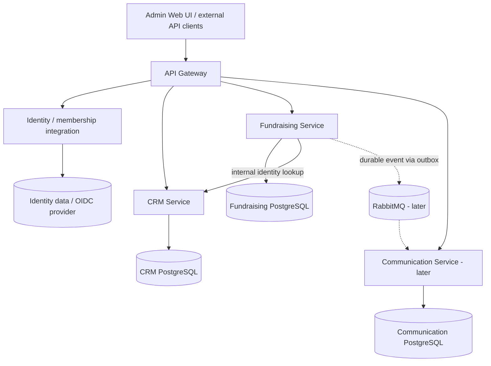

# SocialBridge — Architecture and service boundaries

## Overview
Use a **microservice-oriented monorepo**, with Java 21 and independently deployable Spring Boot services. Domain boundaries are more important than the number of processes. Do not introduce a separate service for each entity. Local environment via Docker Compose, CI via GitHub Actions.



`API Gateway`, `Identity` and `Communication` are **planned** and not currently implemented. The diagram is a target state, not a running topology. Do not silently make public-facing services available without verified authentication, authorization and tenant scoping. For early local-only development, isolate or disable network access to unprotected endpoints.

## Service ownership

| Service | Owns | Does not own | Initial status |
| --- | --- | --- | --- |
| `crm-service` | Contacts, tags, contact categories, consent history, contact lookups | Payment ledger, email sending | Starter present |
| `fundraising-service` | Campaigns, donation records, financial aggregates, idempotency | Contact PII, card processing | Planned second service |
| `identity-service` / OIDC provider integration | Authentication, organization membership, roles, access decisions | CRM donor records | Design first, implement before real data |
| `communication-service` | Templates, opt-outs, outbound queue, delivery records | Source of truth for donor profiles | Planned |
| `gateway-service` | Edge routing, token validation/rate limits | Business rules and authorization source of truth | Planned |

## Identity and multitenancy
- Org memberships verified by the backend; JWT issuer/signature/audience/expiry validated using OIDC standard libraries.
- `tenantId` or organization selection must resolve to authenticated membership, not be accepted merely because a client supplied it.
- Each persistent tenant-owned record includes `organization_id`, indexed. Repository and service APIs enforce it; test for IDOR and cross-tenant query isolation.
- Platform operations require explicit operator permissions and logged justification; system admin role is not universal PII bypass.
- Consider Keycloak for local dev, but keep application authorization policy within the services. Use gateway checks **in addition** to service-level access control.

## Data and persistence
- PostgreSQL database per business service (prefer separate DB/user even within one local PostgreSQL container if resource-constrained).
- Flyway for all schema changes; set JPA `ddl-auto=validate` outside isolated tests. No silent `update` in shared environments.
- No cross-service FK or SQL join. Persist only logical donor IDs in Fundraising; consistency handled through versioned API lookups and events.
- Decide contact identity and duplicate uniqueness by tenant: same email in different organizations MUST be allowed. Email may be absent for offline donors.
- Monetary values stored as `NUMERIC(19,2)` (or domain-appropriate exact precision); Java `BigDecimal`, explicit ISO currency and status transitions. Use transactional writes and appropriate uniqueness indexes.
- Use optimistic locking (`@Version`) or clearly documented alternative for competing updates.
- Use a database-backed idempotency table for donation creation/retry handling; scope keys to tenant and operation and reject request-body mismatch on reuse.
- Donor archival, removal and financial retention require design; avoid deleting legally necessary receipts while still honoring lawful deletion requests where applicable.

## APIs and contracts
- Public API prefix `/api/v1`; use RFC 9457 Problem Details where possible.
- DTO validation; never return raw JPA entities or Spring Data internals as stable public contracts; prefer explicit page DTOs with stable shape.
- Default page 0 / size 20, size capped to 100, deterministic sort and stable filtering.
- OpenAPI generated and published locally, reviewed with examples; deprecation/version rules documented.
- Internal service API requires scoped service credentials, bounded timeouts and retry rules; avoid synchronous call chains for every list item.

## Integration and eventual events
- For initial CRM + Fundraising integration use narrow documented REST if it demonstrably helps a user journey; avoid raw direct DB queries.
- Event candidates: `ContactArchived`, `DonationRecorded`, `DonationRefunded`, `ConsentWithdrawn`.
- Events should include eventId, version, timestamp, tenantId, object ID and only minimal required non-PII fields.
- Later introduce RabbitMQ with a **transactional outbox**, durable consumers, duplicate-tolerant processing, dead-letter handling and traceability. No unreliable publish-after-commit workaround.
- Events should not replace authorization checks, nor cause emailing without rechecking consent.

## Suggested repository structure
```text
socialbridge-platform/
├── pom.xml
├── docker-compose.yml
├── .github/workflows/ci.yml
├── CLAUDE.md
├── README.md
├── docs/
│   ├── PRODUCT_REQUIREMENTS.md
│   ├── ARCHITECTURE.md
│   ├── SECURITY_PRIVACY.md
│   ├── API_CONTRACTS.md
│   ├── DELIVERY_PLAN.md
│   └── adr/
├── crm-service/               # exists
├── fundraising-service/       # planned
├── identity-service/          # later if warranted by OIDC integration
├── communication-service/     # later
└── gateway-service/           # later
```

## Avoid premature infrastructure
No distributed transactions, shared JPA model JAR, service discovery registry, cluster orchestration or message broker until operationally justified. Shared modules may contain narrowly scoped utilities or stable API contracts, not mutable domain entities or an implicit single database.
